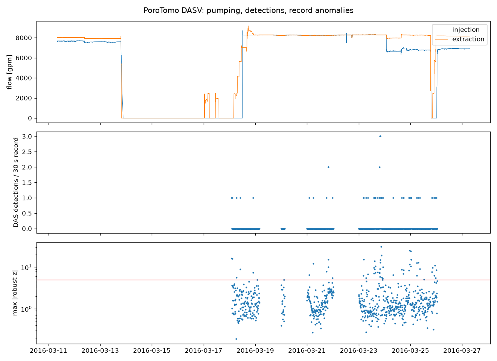

# Agent run: DAS anomalies and the probability of a Pohang-like earthquake at Brady

Run `agent/results/run_20261115T155359Z_s20/` (2026-11-15). Code is in [`agent/`](../agent/README.md). Every number below comes from that run's `summary.json`, `events.csv` and `anomalies.csv`, or from the follow-up checks recorded in [log.md](log.md).

## Question

Do the PoroTomo vertical-DAS (DASV) records show anomalies that could be precursors of injection-induced seismicity? And how likely is an earthquake like Pohang's ([concept-induced-seismicity-pohang.md](concept-induced-seismicity-pohang.md)) given what was observed at Brady?

## Agent design

| Layer | What | Where |
|---|---|---|
| Data | 759 DASV records: every 20th record (one 30 s record per 10 min) out of 15,164 on `s3://nrel-pds-porotomo/DAS/H5/DASV/`, 2016-03-18 02:09 to 2016-03-26 00:59 UTC | `manifest.txt` |
| Detection (distributed) | `detect.py`: per-channel demean, common-mode (median over channels) removal, 10–150 Hz FFT band-pass, STA/LTA 0.05 s / 2 s per channel, trigger when the **median over 384 channels** exceeds 3 | `agent/detect.py` |
| Job | PBS on Aurora, project `IOWarp`, queue `debug`: 2 nodes × 24 ranks, each rank streams its share of the records from S3 through the ALCF proxy into node-local scratch | `agent/pbs/` |
| Aggregation and hazard | robust z-score anomaly flags, event catalogue, pumping volumes, seismogenic index, exceedance probabilities | `agent/hazard.py` |
| LLM | clio-coder (headless `run`, ALCF Metis `gpt-oss-120b`) for a code review and the interpretation; clio-agent blueprint `porotomo-induced-seismicity` (orchestrator + `hdf5` + `seismicity` experts) | `agent/interpret.sh`, `agent/clio-agent/` |

Hazard model: Shapiro, Kim & Ree (2021) Eq. 5, see [concept-seismogenic-index.md](concept-seismogenic-index.md).

## Run

- PBS job 9092130: started 15:57:15, wall time 3 min 12 s, exit 0. Detection took 188 s for 753 records; mean 2.0 s CPU per record.
- 6 downloads failed with proxy `SSL_read: unexpected eof`. `curl --retry` does not retry that error, so they were rerun from the login node. All 759 are now `ok`. The worker now uses `--retry 5 --retry-all-errors`.

## Results

### Anomalies

- **57 of 759 records** exceed a robust |z| of 5 on at least one feature (band RMS, kurtosis, maximum median STA/LTA, spectral centroid, detections per record). In every one of the top 10, the main driver is `max_sta_lta`. The strongest is 2016-03-23 20:50:17 UTC (z = 30.9).
- **62 coherent detections** in 53 records (`events.csv`). Median duration 0.07 s; median fraction of channels above threshold 0.59. On the relative magnitude log10(peak strain rate), Aki b = 0.98 above the max-curvature Mc (34 events).
- **The detections follow the clock, not the pumps.** 47 of 62 fall between 14:00 and 01:00 UTC (07:00–18:00 local, PDT). Hourly Spearman correlations of detections per record against net injection, injection and |Δnet| are −0.17, −0.09 and −0.03. The second shutdown (injection 0 from 2016-03-25 19:13 to 2016-03-26 00:28) shows 6 detections in 29 records (0.21 per record) against 0.077 in all other records. That looks like a shutdown effect, but records from the same hours of the day on other days give 0.18 per record. Then 6 or more is expected with probability 0.43, so there is no shutdown signal once time of day is matched. The most likely sources are daytime activity (vehicles, plant work, the PoroTomo active-source survey). None of these flags is a microearthquake precursor.
- **The DASV records miss the key window.** Injection stopped on 2016-03-13 21:17 UTC and restarted on 2016-03-18 12:12 UTC ([source-brady-pumping-gdr917.md](source-brady-pumping-gdr917.md)). All 5 events in the LBNL catalogue for March 2016 (2016-03-14 to 03-16, ML −0.48 to 0.07; [source-brady-meq-catalog-gdr859.md](source-brady-meq-catalog-gdr859.md)) fall inside that shutdown. The first DASV record on the bucket is 2016-03-18 02:09 (a lone record exists on 03-17). This matches the Brady observation that seismicity rises when pumping stops, not when it runs (Cardiff et al. 2018, EPSL 482). DASV can't confirm it, because DASV wasn't recording then.

### Pumping (GDR 917, 2016-03-11 08:00 to 03-27 07:00 UTC, 15.96 days)

Injected 465,448 m³, extracted 505,933 m³, net −40,485 m³ (more fluid taken out than put in). Of the injected volume, 314,436 m³ went in during the DASV window. Mean injection was 5,336 gpm.

### Probability of a Pohang-like event (Mw ≥ 5.5)

Seismogenic index from the calibrated LBNL catalogue: 5 events with ML ≥ −0.48 over 465,448 m³ injected.

| b | Σ | P(M≥5.5) over the 16 days | P(M≥5.5) per year at this rate | P(M≥5.5) if Pohang's 12,800 m³ were injected | P(M≥3) per year |
|---|---|---|---|---|---|
| 1.0 | −5.45 | 5.2 × 10⁻⁶ | 1.2 × 10⁻⁴ | 1.4 × 10⁻⁷ | 0.037 |
| 0.73 | −5.32 | 2.2 × 10⁻⁴ | 4.9 × 10⁻³ | 5.9 × 10⁻⁶ | 0.28 |
| 0.65 | −5.28 | 6.5 × 10⁻⁴ | 1.5 × 10⁻² | 1.8 × 10⁻⁵ | 0.47 |

- **Check against Pohang:** the same formula with Pohang's Σ of −2 to −1, b of 0.65 or 0.73 and 12,800 m³ gives 1.2 % to 29 % (Σ = −1, b = 0.73: 12 %). The paper's worst case is 15–17 %, so the implementation reproduces the published order of magnitude.
- **Brady against Pohang:** Brady's Σ is about 3.3 to 4.4 log units below Pohang's. Per cubic metre injected, a magnitude threshold is crossed roughly 2,000 to 25,000 times less often. A 1 % chance of Mw ≥ 5.5 over the observed 465,448 m³ would need Σ ≥ −2.17 (b = 1), −3.65 (b = 0.73) or −4.09 (b = 0.65). Brady sits 1.2 to 3.3 log units below each of these.
- **Pohang's low b is implausible here.** With b = 0.65 or 0.73 the model predicts an M ≥ 3 at Brady every 2–4 years. The table gives 0.28 to 0.47 per year, and no such events appear in the LBNL record (its array has run since 2010; see sources in [source-brady-meq-catalog-gdr859.md](source-brady-meq-catalog-gdr859.md)). b ≈ 1 fits the site better and gives **≈ 1 × 10⁻⁴ per year for Mw ≥ 5.5** under PoroTomo-era operations.
- **DAS-based upper bound (not calibrated):** this counts every DAS detection as an event at or above the catalogue Mc, scales by the 3.3 % of time sampled, and uses b = 0.98. It gives Σ = −2.70 and P(M≥5.5) = 2.4 × 10⁻³ over the DASV window, 7.8 × 10⁻² per year. It overstates the hazard, because the detections are mostly cultural noise with no magnitude calibration. It is reported only as a ceiling.

## Limitations

- The catalogue has only 5 events, so Σ has an uncertainty of roughly ±0.4 log units from Poisson counting alone. b can't be fitted from it and was taken from scenarios.
- Shapiro's model uses injected volume. Brady extracted more than it injected (net −40,485 m³), and its seismicity responds to stopping, not to volume. Gross injected volume is used here as the conservative choice.
- The detector has no template matching, no picking or location, no magnitude calibration, and no separation of cultural noise. One record per 10 minutes covers 3.3 % of the time.
- Mw 5.5 needs a fault large enough to host it. The model only extrapolates the Gutenberg–Richter law and knows nothing about the faults at Brady.

## LLM steps and their reliability

- The clio-coder code review (`agent/results/llm/clio_coder_code_review.md`) was useful. Fixes taken from it: an LTA window guard, zero-volume and empty-catalogue guards, and clearer `first_depth` semantics.
- The clio-coder interpretation (`interpretation.md` in the run directory) got three things wrong. It read "stride 20" as 20 s. It called the DAS upper bound "calibrated". It reversed the Σ-needed comparison. A reviewer note now heads the file. Don't use LLM summaries of this run without checking them against `summary.json`.
- clio-agent: the blueprint could not run during this run, because the server had no ALCF Globus token. After the login it ran on ALCF Minerva Mistral Large 4 (`mistral-large-4-nvfp4`), driven by `agent/clio-agent/run_query.py` (see [log.md](log.md), 2026-11-15). The first attempt stalled for 900 s after `hdf5_open_file`. After a server restart, `main` delegated to `hdf5`, which used only the approved read-only `hdf5_open_file` and `hdf5_close_file`, and answered in 46.3 s. Every dataset, shape, dtype, the chunking and the `/crs` attributes matched h5py. Its only unsupported claim was calling the file a "shot record". On 2026-11-16 the `seismicity` expert ran too (shell allowed, read-only brief): `main` spawned it, it made 3 approved `shell_bash` calls, and the answer came back in 57.5 s. Every count, Σ and probability it quoted matches `summary.json` exactly, it labelled the catalogue values as calibrated and the DAS value as an upper bound, and it submitted no job and changed no file. Transcripts are in `agent/results/llm/clio_agent_minerva_*`; setup is in [`agent/README.md`](../agent/README.md).

## Related

- [concept-seismogenic-index.md](concept-seismogenic-index.md), [concept-induced-seismicity-pohang.md](concept-induced-seismicity-pohang.md)
- [source-brady-pumping-gdr917.md](source-brady-pumping-gdr917.md), [source-brady-meq-catalog-gdr859.md](source-brady-meq-catalog-gdr859.md), [source-shapiro-2021-pohang.md](source-shapiro-2021-pohang.md)
- [source-dasv-PoroTomo_iDAS025_160318160317.md](source-dasv-PoroTomo_iDAS025_160318160317.md) (record layout)
